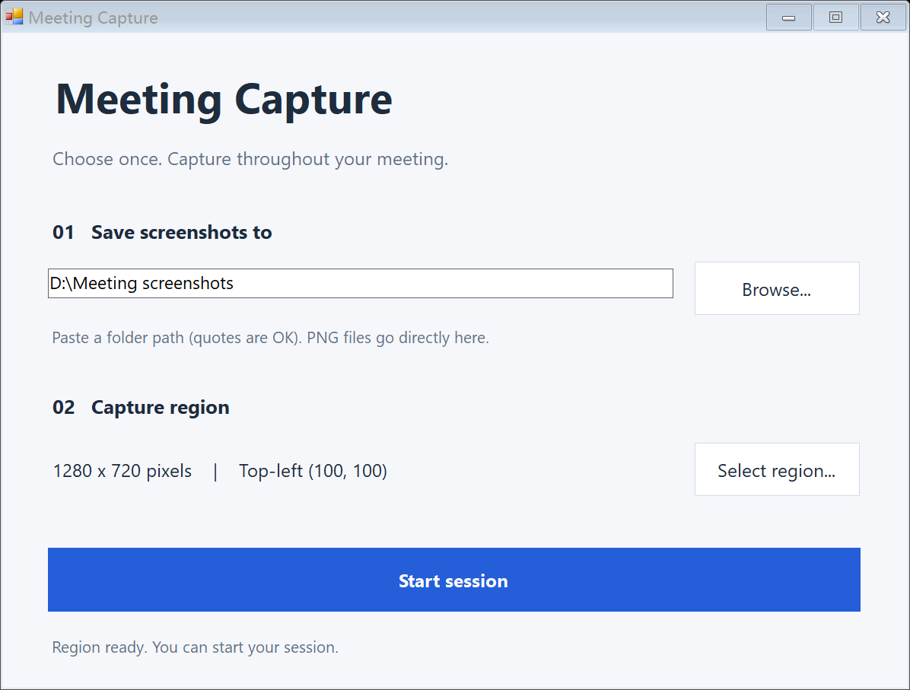
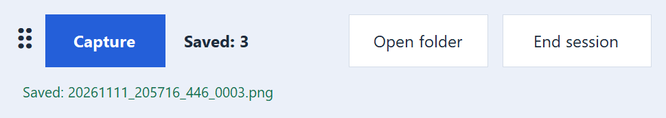

# Meeting Capture

A small, portable Windows app for saving repeated screenshots of one fixed screen region. Select your slide area once, then click **Capture** throughout a meeting or presentation.

**Windows 10/11 x64 · Single EXE · No installer · No Python or Office required**



## Download and use

Download `MeetingCapture-1.1.0-windows-x64.zip` from [Releases](https://github.com/rbnrong/meeting-capture/releases/latest), extract it, and open `MeetingCapture.exe`.

1. Type or paste an existing **Output folder**, or click **Browse...**. Surrounding quotes and whitespace are removed automatically, including Windows **Copy as path** quotes and smart quotes.
2. Click **Select region...**, drag a rectangle, and release to confirm. Press **Esc** or right-click to cancel.
3. Click **Start session**. A small toolbar stays above your other windows.
4. Click **Capture** whenever you need a screenshot. The toolbar hides briefly and returns after the PNG is saved.
5. Click **Open folder** to view saved images, or **End session** to return to setup.



Move the toolbar by dragging its left handle, counter, or status text. Moving it does not change the capture region.

## Behavior

- Saves PNG files directly to the selected folder, for example `20261111_193025_123_0001.png`. No meeting name or other prefix is added.
- Preserves existing files by adding a suffix when names collide. The counter increases only after a successful save.
- Captures physical screen pixels, including regions on secondary monitors or across monitor boundaries with different scaling settings.
- Excludes the mouse pointer, selection border, and this app's toolbar from screenshots.
- Keeps the presentation in the foreground when **Capture** is clicked. Opening the folder intentionally switches to File Explorer.
- Ignores repeated capture requests while busy. While hidden, it briefly blocks additional left-click pairs at the toolbar's previous position to prevent a double-click from advancing the slide underneath.
- Pauses capture after a display layout, resolution, or scaling change. End the session and select the region again.
- Remembers the last output folder at `%LOCALAPPDATA%\MeetingCapture\last-folder.txt`. Each new session requires a fresh region selection.

The region stays at fixed screen coordinates; it does not follow a presentation window if that window moves. Save failures are shown in the toolbar; hover over the message to read the full reason. The app does not choose a different output folder silently.

Screenshots and settings stay on your computer. The app makes no network requests. Windows-owned dialogs and system error messages follow the operating system's language.

## Build

Run `build.cmd` on Windows. It uses the C# compiler included with Windows' .NET Framework and creates `dist\MeetingCapture.exe`.

```bat
build.cmd
```

No SDK, package restore, Python, or third-party runtime is needed. The icon and DPI manifest are embedded in the EXE. To produce the portable ZIP and SHA-256 checksums:

```powershell
powershell -NoProfile -ExecutionPolicy Bypass -File .\build-release.ps1
```

The optional `make-icon.py` script rebuilds the bundled original icon using only Python's standard library. It is not required to build or run the app.

## Compatibility and validation

The app uses the .NET Framework 4.x desktop components included with ordinary Windows 10/11 installations and runs without administrator privileges.

Interactive checks were performed on Windows 11 x64 using 3840×2160 at 175% and 2560×1600 at 150%. The original implementation was checked with PowerPoint fullscreen mode, 20 consecutive captures, filename collisions, invalid folders, display-change handling, and double-click protection. The English UI is checked separately for readable labels, path pasting, and screenshot saving.

An independent Windows 10 machine, a clean machine without development tools, and physical monitor hot-plugging have not been tested. CI builds and packages the app on Windows; it does not validate an interactive desktop or PowerPoint behavior.

## Development

See [CONTRIBUTING.md](CONTRIBUTING.md) for the build and manual verification checklist, and [CHANGELOG.md](CHANGELOG.md) for changes. Generated binaries, screenshots used during testing, and logs are excluded from source control; the images under `docs/images/` are product documentation.

## License

[MIT](LICENSE) © 2026 rbnrong. The bundled app icon was created for this project.
